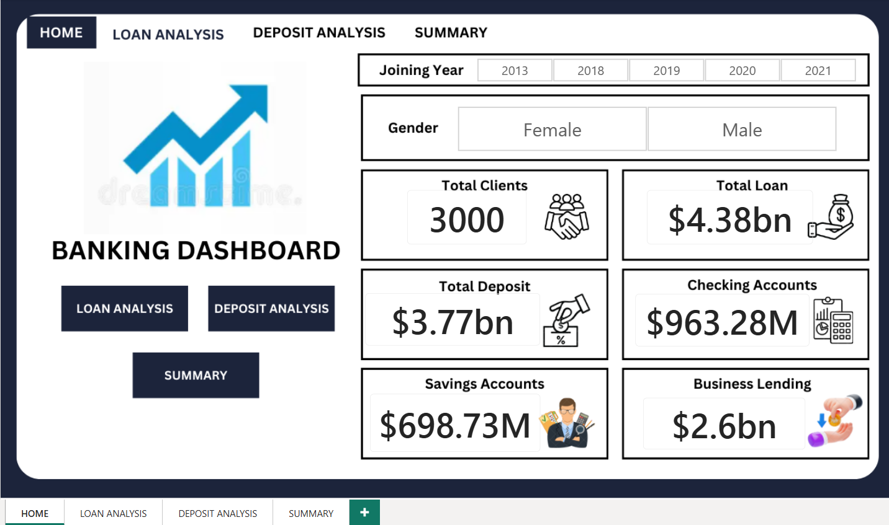
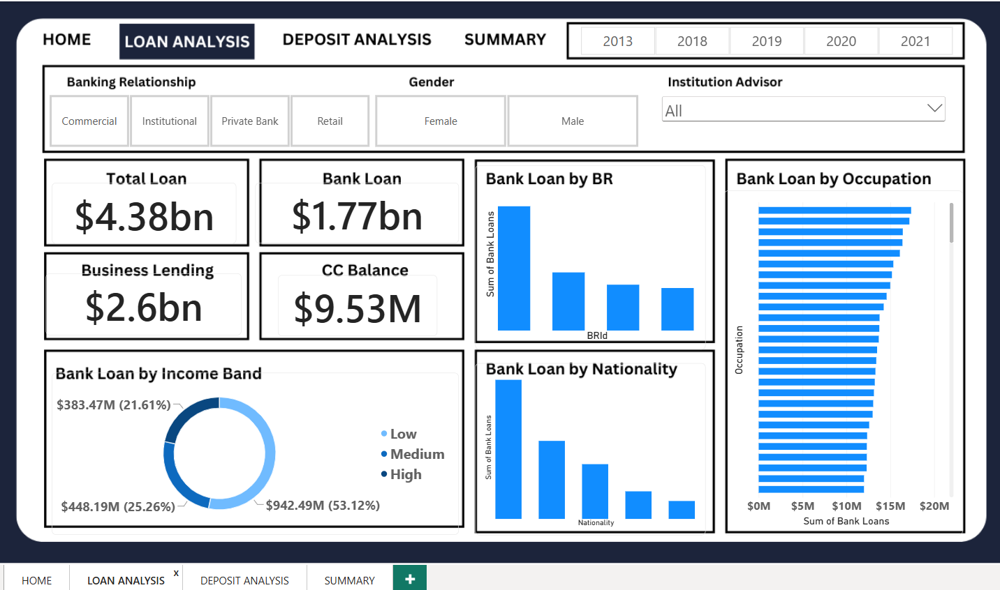
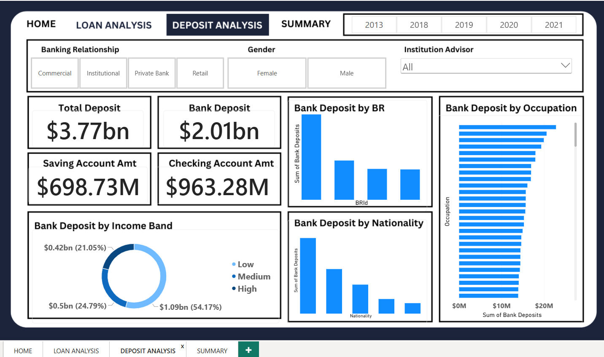
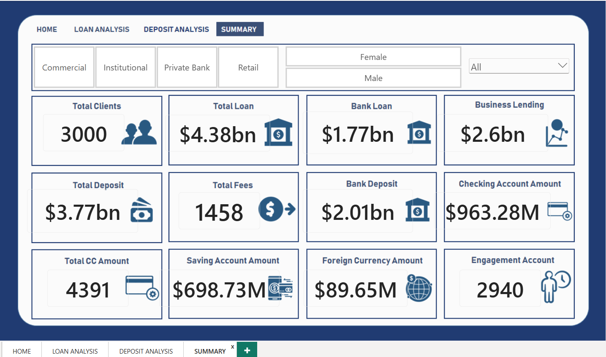

# 🏦 Banking Data Analytics

An end-to-end Banking Data Analytics project focused on analyzing customer demographics, loan distribution, deposit patterns, and banking engagement using Python, SQL, and Power BI.

## 📌 Project Overview

The objective of this project is to explore banking customer data, identify meaningful patterns, and present key financial metrics through an interactive Power BI dashboard.

The project includes Exploratory Data Analysis (EDA), data visualization, dashboard development, and project documentation.

## 🎯 Project Objectives

- Analyze banking customer demographics and behavior.
- Explore loan and deposit distribution.
- Understand customer financial patterns.
- Create an interactive Power BI dashboard.
- Present key metrics through visualizations.
- Develop practical data analytics and business intelligence skills.

## 🛠️ Tools & Technologies

| Tool | Purpose |
|---|---|
| Python | Data analysis |
| Pandas | Data manipulation |
| Matplotlib | Data visualization |
| Seaborn | Statistical visualization |
| Jupyter Notebook | EDA environment |
| SQL / MySQL | Data querying |
| Power BI | Dashboard development |
| Microsoft Excel | Dataset inspection |

## 📂 Repository Structure

```text
Banking-Data-Analytics/
│
├── DASHBOARD/
│   └── Banking_Dashboard.pbix
│
├── NOTEBOOK/
│   └── Banking_Eda_Project.ipynb
│
├── PPT/
│   └── Banking_Dashboard.pptx
│
├── REPORT/
│   └── Banking_Report.docx
│
├── SCREENSHOTS/
│   ├── Home.png
│   ├── Loan_Analysis.png
│   ├── Deposit_Analysis.png
│   └── Summary.png
│
├── datasets/
│   ├── Banking.csv
│   ├── Banking.xlsx
│   ├── banking-clients.csv
│   ├── banking-relationships.csv
│   ├── clients.csv
│   ├── gender.csv
│   └── investment-advisors.csv
│
└── README.md
```

## 📊 Power BI Dashboard

The Power BI dashboard consists of four main pages.

### 1. Home Dashboard

Provides an overview of the banking dashboard and key metrics.

[🔗 View Home Dashboard Screenshot](SCREENSHOTS/Home.png)



### 2. Loan Analysis

Analyzes loan-related metrics, including total loan, bank loan, and business lending.

[🔗 View Loan Analysis Screenshot](SCREENSHOTS/Loan_Analysis.png)



### 3. Deposit Analysis

Provides insights into customer deposits, savings accounts, checking accounts, and deposit distribution.

[🔗 View Deposit Analysis Screenshot](SCREENSHOTS/Deposit_Analysis.png)



### 4. Summary Dashboard

Presents an overall summary of banking metrics, including total clients, total loan, total deposit, and account-related values.

[🔗 View Summary Dashboard Screenshot](SCREENSHOTS/Summary.png)



## 📈 Key Performance Indicators (KPIs)

The dashboard includes the following metrics:

- Total Clients
- Total Loan
- Total Deposit
- Bank Loan
- Business Lending
- Bank Deposit
- Checking Account Amount
- Saving Account Amount
- Foreign Currency Amount
- Total Credit Card Amount
- Customer Engagement

## 🔍 Exploratory Data Analysis

The EDA process was performed using Python and Jupyter Notebook.

The analysis includes:

- Dataset loading and inspection
- Data structure and data type analysis
- Missing-value checking
- Duplicate-value checking
- Descriptive statistics
- Income band analysis
- Categorical variable analysis
- Numerical distribution analysis
- Correlation analysis
- Relationship analysis between selected variables
- Data visualization using Matplotlib and Seaborn

## 🔄 Project Workflow

1. Data collection and loading
2. Data inspection and validation
3. Exploratory Data Analysis using Python
4. Analysis of banking customer metrics
5. Power BI dashboard development
6. Dashboard visualization and reporting
7. Documentation and presentation preparation

## 📁 Project Resources

- [📓 Jupyter Notebook — EDA](NOTEBOOK/Banking_Eda_Project.ipynb)
- [📊 Power BI Dashboard File](DASHBOARD/Banking_Dashboard.pbix)
- [📄 Project Report](REPORT/Banking_Report.docx)
- [📽️ Project Presentation](PPT/Banking_Dashboard.pptx)
- [🖼️ Dashboard Screenshots](SCREENSHOTS/)

## 💡 Key Learnings

- Practical experience in exploratory data analysis.
- Data manipulation and visualization using Python.
- Understanding banking customer and financial metrics.
- Developing interactive dashboards using Power BI.
- Presenting analytical findings through reports and presentations.
- Organizing and documenting an end-to-end analytics project.

## 📝 Conclusion

This project demonstrates an end-to-end data analytics workflow, from exploring banking customer data to building an interactive Power BI dashboard.

The dashboard provides a consolidated view of customer, loan, and deposit metrics, helping present banking data in a structured and understandable way.

## ⚠️ Disclaimer

This project is created for educational and portfolio purposes. The insights and metrics are based on the available dataset and project analysis.

